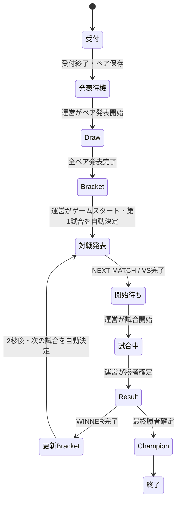

# 受付からChampionまでの大会運営フロー

最新の第1試合→第2試合の接続・公開検証は [MATCH_PROGRESS_LOOP.md](MATCH_PROGRESS_LOOP.md) を参照。WINNER後に更新済みBracketを独立表示してから、次VSへ自動で進みます。

**2026-10-25更新：開始前の操作は[ペア発表フロー](PAIR_ANNOUNCEMENT_FLOW.md)を優先してください。** 受付終了でペアを事前保存し、「ペア発表開始」→Draw→Bracket待機→「ゲームスタート」→第1試合VS待機、に変更しました。以下の7試合完走は変更前の検証記録です。

2026-10-25：既存の大会ロジックと既存演出を接続し、公開済み。通常運営に試合一覧からの選択はありません。次の試合は既存 `getNextMatch` が決めます。

## 公開URL

| 用途 | URL |
|---|---|
| 通常大会・受付 | https://tournament-checkin-rehearsal.pine-shaken.workers.dev/checkin |
| 通常大会・運営 | https://tournament-checkin-rehearsal.pine-shaken.workers.dev/admin |
| 通常大会・Display | https://tournament-checkin-rehearsal.pine-shaken.workers.dev/display |
| 8名・4チームの完走済み検証大会 | https://tournament-flow-e2e.pine-shaken.workers.dev/display |
| 完走済み検証大会の運営確認 | https://tournament-flow-e2e.pine-shaken.workers.dev/admin |

確認コードは従来と同じ。[保存先](../.checkin-access.local)。開いたままの画面は一度再読み込みし、更新後の画面を使用してください。完走済みの検証大会は終了状態を保持しています。

## 運営者の操作

1. 写真・名前・任意ratingを登録し、受付を終了します。
2. 受付終了でペア・公開順・Bracketを保存済みです。運営画面で「ペア発表開始」を押し、既存Drawで発表します。
3. 発表完了後、Bracketで待機します。運営が「ゲームスタート」を押すと、システムが最初の実施可能な試合を選びます。
4. NEXT MATCH / VSが再生され、**試合開始待ち**になります。
5. 実際の試合を始めるときに「試合開始」を押します。
6. 試合終了後、表示中の2チームから「○○の勝利を確定」を押し、名前を確認します。
7. Result / WINNER → Bracket更新 → 次の試合の自動決定 → NEXT MATCH / VS → 開始待ち、と進みます。
8. 決勝の勝者が決まるとResult / WINNER → CHAMPION → 大会終了へ進みます。

通常は手順5・6を繰り返すだけです。「次へ」や試合選択リストの操作は不要です。VS演出の途中での開始、未開始試合の結果入力、古い画面からの勝者変更はサーバーでも拒否します。勝者を自動入力したり、実際の試合時間をタイマーで終了したりしません。

## 再利用した実装

- ペア：`makeBalancedTeams` / `buildRevealOrder`。
- Bracket：`buildDoubleElimination` / `createManagerFromSnapshot` / `exportSnapshot`。
- 次試合：`getNextMatch`。既存の実施可能判定と順序に従い、Ready/Runningの試合を取得します。
- 勝敗：`applyResult`。敗者復活、決勝リセット、優勝判定も既存brackets-managerへ委譲します。
- 優勝：`getChampionTeamId`。
- Draw：既存 `DrawStage` / `PairConfirmed` / `drawAnimationTiming`。
- Result・Bracket advance・NEXT MATCH・VS：既存 `PostMatchStage` の該当区間を接続。
- Champion：既存のデータ受渡し型Champion描画を利用。
- 実Bracket：既存 `BracketView` にD1のsnapshot・確定team・保存写真を渡します。

新しい抽選アルゴリズム、演出デザイン、タイミング値は追加していません。Bracket snapshotはペア確定と同じトランザクションで事前に準備し、Draw完了後に表示します。個別 `/show-preview` は表示調整用として残し、実際の大会進行は `/admin` と `/display` の共通状態で動かします。

## 永続化・再接続

正本は既存のD1テーブルです。

| データ | 保存先 |
|---|---|
| 固定参加者 | participants / checkin_state.closed_roster |
| 確定ペア | draw_sessions / teams / team_members |
| 進行・勝敗の正本 | events.bracket_snapshot |
| 現在の試合 | events.bm_current_match_id / event_state.current_match_id |
| 試合レコード | matches。snapshotの試合IDに対応する安定IDで投影 |
| 表示・待機状態 | event_state.scene / scene_payload / version / scene_seq / scene_started_at |
| 再送保護 | command_receipts |

試合開始でsnapshotとmatchesをRunningにし、勝者確定で同じbatch内に勝敗・更新snapshot・matches投影・Result sceneを保存します。receiptのversionと試行IDで同時操作を保護し、途中失敗はrollback。既存receiptの同じ操作は再適用しません。写真・ペアを再生成しません。

sceneとsnapshotは同じSELECTから読み、別versionの試合情報が混ざらないようにしています。Displayは既存の1秒間隔取得を使用。演出終了はサーバー時刻でも確認して自動遷移し、`vs_card` と `match_live` は人の操作を待ちます。次の試合は結果反映後のsnapshotから選び直します。

再接続では同じsession・match・versionから復帰します。演出中は経過位置へseek、試合中は同じ試合の待機表示、終了後は同じChampionを表示します。通信切断時にブラウザ側で次試合や勝者を推測して進めません。

## API

いずれも従来のHttpOnlyセッションが必要です。ブラウザにAdmin API TokenやDISPLAY_API_TOKENを追加していません。

| API | 用途 |
|---|---|
| `GET /api/draw/state` | 共通状態。flow.currentMatch、canStart、canScore、canAdvance、勝者、Championを含む |
| `POST /api/tournament/advance` | 演出後の自動遷移。UUID・expectedVersion・サーバー経過時間を確認 |
| `POST /api/tournament/start` | 現在の自動選択済み試合を開始 |
| `POST /api/tournament/winner` | 現在の試合のwinnerSlotを確定 |

start/winnerに任意の次試合IDを渡す操作はありません。サーバーが保持する現在試合だけを対象にします。自動遷移が複数端末で競合した場合は1件だけcommitし、他端末は新しいversionを再取得します。

## 公開E2E

大会 `cf-flow-e2e-20261025` に8名を実際の受付画面から登録し、写真をprivate R2、参加者をD1へ保存。受付終了・Drawを経て、4チーム・7試合を実行しました。

- 勝者側3試合、敗者側2試合、決勝2試合（リセットあり）。
- 次の試合選択・手動「次へ」なし。操作は各試合の開始と勝者確定のみ。
- VS完了後に時間が経っても自動で試合開始しないことを確認。
- 試合中のDisplay reloadで同じ試合・versionに復帰。
- 各結果のWINNER表示、更新Bracket、次対戦表示、最後のChampionを確認。
- Champion：**進行検証 06 ＆ 進行検証 03**。
- D1：matches 7件すべてdone、各winner_team_idと画面の結果が一致。snapshot一致。events.status=finished、current match=null、event_state.scene=finished、version=25。
- 終了後のreloadでも同じChampion。
- ブラウザJSエラー0、未処理HTTP失敗0。自動遷移競合409は再取得で処理。

8名の画像は既存テスト画像を登録画面からアップロードしたデータです。実参加者8名による実機撮影ではありません。テスト端末のCSP待機処理・DNS/接続問題で途中再接続しましたが、参加者・ペア・結果をリセットせず同じ大会で最後まで継続しました。

証跡はGit除外の `.wrangler/tournament-flow-e2e/result.json`、`reception-eight.png`、`next-match-hold.png`、`result-1..7.png`、`champion.png`。再現スクリプトは `scripts/verify-tournament-flow.cjs`。既存データの自動削除や大会リセットは行いません。

## 通常大会の状態

2026-10-25 04:16 JST：通常大会 `cf-rehearsal-001` は「にゃー」「けんけん」「テスト」「テスト2」の4名、受付終了・Draw済みです。既存session `fc819566-8c6a-4d6b-8f6a-08bfaeb3224a` とペアを保持しました。

- Pair 1：けんけん ＆ テスト2（team `aece090e-bcb7-4c76-b493-cada1db7d749`）
- Pair 2：テスト ＆ にゃー（team `479906a6-eee8-49aa-80c0-b6ad9365245e`）
- システムがmatch 0を選び、NEXT MATCH / VSを表示。scene=`vs_card`、version=3、canStart=true。
- 試合選択UIは0件。待機時間が経っても試合中へ勝手に進まないことを確認。
- 通常大会は2チームなので、既存Bracketロジックで最初の試合がFINALです。
- こちらから参加者変更・試合開始・勝者入力は行っていません。完走テストは隔離大会で実施し、通常大会は運営者の操作待ちにしています。

運営画面を再読み込みし、「試合開始」→実際の試合→勝者確定の順で操作してください。通常大会自体の実戦による勝敗入力からChampionまでは、運営者の結果入力待ちです。証跡は `.wrangler/tournament-flow-e2e/primary-status.json` とGit除外の確認画像に保存しました。本人写真を公開ドキュメントへ添付していません。

公開Version：通常 `9b298cec-8628-4c64-9357-c646d1a4f7f7`、隔離検証 `f73a5399-964b-46e4-8ea6-dda3c28b756d`。

## 変更・検証

- `cloudflare/checkin/src/flow.ts`：既存進行ロジック、matches投影、CAS・receipt、自動遷移・開始・勝者入力。
- `cloudflare/checkin/src/draw.ts`：同一snapshotの状態取得、既存Draw完了と連続進行の接続。
- `cloudflare/checkin/src/flow.test.ts`：全進行・決勝リセット・同時勝者入力・rollback・開始待ち検証。
- `src/checkin/DrawControl.tsx`：運営の現在試合・開始・勝者確定、共通状態監視、自動遷移。
- `src/checkin/FlowPresentation.tsx`：D1チームを既存演出・Bracketへ接続。個別Previewの手動操作を持ち込まない。
- `src/checkin/api.ts`・`presentationAdapter.ts`：進行エラーと隔離検証大会の許可。
- `cloudflare/checkin/wrangler.flow-e2e.jsonc`：検証用Workerの固定大会設定。
- `scripts/verify-tournament-flow.cjs`：公開UI・API・D1の完走照合。
- 本書・PLAN・関連運用資料：最新の運営手順と検証記録。

`npm run build:checkin`・`npm run build` 成功。167 tests成功。新規依存のインストール・DB migrationは不要でした。通常受付Workerと新しい隔離検証Workerへ公開し、旧Supabase環境・サンプル専用Previewは再公開していません。
